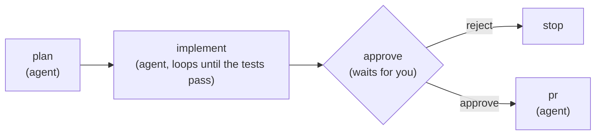

# Archon

*Cara paling sederhana untuk membangun perangkat lunak yang membangun perangkat lunakmu. Workflow YAML yang bisa melakukan apa saja.*

> **Catatan dari situs ini:** (1) **Telemetri anonim menyala secara default.** README merincinya (nama workflow bundel, bentuk dan hasil run, total token dan biaya, konteks mesin, UUID instalasi acak; tidak ada kode, prompt, atau data pribadi). Matikan dengan `ARCHON_TELEMETRY_DISABLED=1` atau `DO_NOT_TRACK=1`; CI (`CI=true`) otomatis dimatikan. (2) README menawarkan pemasangan `curl … | bash` dan `irm … | iex`, yaitu perintah yang mengunduh skrip lalu langsung menjalankannya. Domainnya milik proyek sendiri; perintah itu disalin di bawah, tetapi perintah pasang utama entri ini memakai Homebrew. (3) Archon menjalankan agent coding dengan akun dan langgananmu sendiri, dan pack `sdlc` bisa meng-merge pull request lewat GitHub CLI; trigger tidak terikat secara default, tetapi batasi izinnya dan tinjau gerbang persetujuan sebelum membiarkannya berjalan otomatis. (4) Angka "363 dari 524 PR dibangun Archon" adalah klaim pembuat repo. (5) Bagian badge dan riwayat bintang tidak disalin.

Archon adalah pembangun pabrik (factory builder). Kamu menjelaskan bagaimana pekerjaan harus dikerjakan sebagai workflow YAML, dan Archon menjalankannya dengan agent AI, skrip, dan keputusanmu di tempat yang membutuhkannya. Perangkat lunak adalah pabrik pertama: pack SDLC bawaan membawa sebuah issue sampai pull request yang di-merge. Engine yang sama menjalankan proses apa pun yang bisa kamu jelaskan.

Keluarkan dirimu dari dalam loop dan duduklah di atasnya. Run mengerjakan pekerjaan, antrean menjaganya tetap bergerak, dan sebuah run datang kepadamu hanya saat ia butuh keputusan yang menjadi milikmu.

## Mengapa Archon

Minta agent coding memperbaiki bug dan hasilnya bergantung pada eksekusinya. Ia mungkin melewati rencana, lupa tes, atau mengabaikan template PR kamu. Akhirnya kamu mengawasi setiap langkah.

Archon mengubah prosesmu menjadi workflow yang kamu miliki. Workflow menetapkan langkah, pemeriksaan, dan gerbang. Agent memberi penilaian di dalam setiap langkah. Itu memberimu:

- **Proses yang sama setiap kali.** Rencanakan, implementasikan, review, validasi, buka PR, dalam urutan yang kamu tulis.
- **Manusia di atas loop, bukan di dalamnya.** Antrean memajukan pekerjaan sendiri. Saat sebuah run mencapai keputusan yang tak bisa diambilnya, ia berhenti sebagai satu item perhatian: apa itu, mengapa penting, rekomendasi, dan pilihannya. Kamu menjawab dan ia melanjutkan.
- **Tata kelola bawaan.** Gerbang persetujuan, log peristiwa lengkap dan transkrip untuk setiap run, dan biaya setiap run, semuanya disimpan di database kamu sendiri.
- **Agent kamu, langgananmu.** Archon bukan agent coding lain. Ia menjalankan Claude Code, Codex, dan Pi lewat CLI dan SDK mereka sendiri, dengan akun dan panduan proyek yang sudah kamu punya.
- **Self-hosted.** Satu pemasangan di mesin atau servermu. SQLite secara default, PostgreSQL bila kamu mau.

## Tampilannya

Workflow adalah graf node. Agent menilai, kode menghitung, dan kamu memutuskan di tempat yang penting:

```yaml
# .archon/workflows/build-feature.yaml
name: build-feature
description: Plan, implement until the tests pass, ask for approval, open the PR.
nodes:
  - id: plan
    prompt: "Read the request and the code. Write an implementation plan."

  - id: implement
    depends_on: [plan]
    loop:
      prompt: "Implement the next step of the plan."
      until_bash: "bun run test"          # your test command; code decides when it is done
      max_iterations: 10
      fresh_context: true

  - id: approve
    depends_on: [implement]
    wait:                                 # the run pauses and asks you
      attention: "Review the change. Approve, or reject to stop."
      form: approval

  - id: stop
    depends_on: [approve]
    when: "$approve.output.decision == 'reject'"
    cancel: "Rejected at review."

  - id: pr
    depends_on: [approve]
    when: "$approve.output.decision == 'approve'"
    prompt: "Push the branch and open a pull request."
```



Simpan di `.archon/workflows/` repositorimu, ganti `bun run test` dengan perintah tesmu sendiri, dan jalankan:

```bash
archon workflow run build-feature "Add dark mode to the settings page"
```

Run pada repositori mendapat git worktree sendiri secara default, sehingga beberapa run bisa bekerja di satu repositori sekaligus.

## Pabrik perangkat lunak: issue masuk, PR ter-merge keluar

Pack `sdlc` bawaan adalah pabrik yang berfungsi untuk sebuah repositori:

1. **Kamu membuka issue.** `archon-intake` memeriksanya terhadap kode saat ini dan memutuskan apa yang dibutuhkan: rencana, investigasi, langsung ke pengiriman, atau tinjauan maintainer.
2. **Antrean build mengambilnya.** `archon-build-queue` mengklaim issue siap berikutnya, menulis brief, dan menjalankan `archon-ship`: rencana, implementasi, review lewat lensa spesialis, perbaiki temuan, tunggu CI. Ia berhenti di pull request yang reviewnya berstatus Ready, bertanya sekali untuk pemeriksaan apa pun yang tidak bisa dijalankan putaran mana pun, atau di PR yang jawaban `ready` dari maintainer meneruskannya; gerbang merge memeriksa keduanya dengan cara yang sama.
3. **Antrean merge mendaratkannya.** `archon-merge-queue` me-merge pull request siap yang jelas dan bisa di-merge bersih, lewat gerbang yang memeriksa vonis review dan CI pada commit head serta bahwa branch dasar tidak merah. Antrean menilai thread review yang terbuka sendiri dan mengirim pull request yang konflik kembali ke antrean build.
4. **Kamu menjawab yang belum jelas.** Pertanyaan cakupan, perubahan skema, atau putaran yang macet menjadi satu item perhatian dengan rekomendasi. Jawabanmu ditulis ke issue sebagai cakupan baru.
5. **Tidak ada temuan di sepanjang jalan yang hilang.** `archon-discoveries` membaca apa yang diperhatikan run di luar tugasnya dan mengajukannya, melacaknya di issue yang ada, atau membuangnya.

Archon membangun Archon: dari 524 pull request yang di-merge ke repositori ini antara 1 dan 19 Oktober 2026, run Archon membangun 363.

Kamu memulai antrean secara manual atau mengikatnya ke jadwal atau peristiwa issue dengan [trigger](https://archon.diy/guides/workflow-triggers/). Pack tidak mengikat apa pun secara default. Pack bekerja lewat GitHub CLI (`gh`) saat ini; lihat [jalur forge](https://archon.diy/reference/forge/#use-the-forge-path-in-the-sdlc-pack) untuk rute plugin. [Siapkan pabrik SDLC](https://archon.diy/getting-started/sdlc-factory/) menjalankannya di repositorimu, dan [workflow pack SDLC](https://archon.diy/reference/sdlc-workflows/) menjelaskan setiap workflow di dalamnya.

## Bangun pabrik apa pun

Workflow tidak terikat pada kode. Sebuah node bisa berupa prompt agent, perintah bash, skrip, loop, penantian manusia, atau workflow anak, sehingga proses apa pun dengan langkah, pemeriksaan, dan keputusan cocok: produksi konten, riset, operasi, dukungan. Tulis sebagai YAML, simpan perintah dan skripnya di sampingnya, dan bagikan sebagai pack.

## Inti yang andal, bisa diperluas di sambungannya

Intinya tetap kecil: engine workflow, isolasi, state tahan lama, antrean perhatian, dan jejak audit. Semua yang berbicara dengan dunia luar dipasang lewat kontrak yang dipublikasikan, dan kamu bisa membangun plugin sendiri untuk semuanya:

| Jenis plugin | Yang ditambahkan | Dipelihara di sini |
|---|---|---|
| Workflow pack | Workflow, perintah, dan skrip | `sdlc` |
| Provider | Runtime agent | Claude Code, Codex, Pi |
| Forge | Host kode | GitHub |
| Chat | Permukaan percakapan | Slack |

GitHub adalah registri: publikasikan di repositorimu sendiri dan pasang dengan `archon plugin add owner/repo`. Lihat [Publikasikan plugin](https://archon.diy/guides/publishing-plugins/) dan [indeks plugin](https://archon.diy/plugins/).

## Mulai cepat

1. Pasang [Claude Code](https://claude.ai/code) dan login, atau pasang Codex.
2. Pasang Archon. Installer menanyakan provider mana yang ditambahkan:

   ```bash
   curl -fsSL https://archon.diy/install | bash        # macOS / Linux
   irm https://archon.diy/install.ps1 | iex             # Windows (PowerShell)
   brew install coleam00/archon/archon                 # Homebrew, lalu: archon setup
   ```

3. Jalankan workflow di repositori git mana pun:

   ```bash
   cd your-project
   archon workflow list
   archon workflow run archon-investigate "Why does the login test fail?"
   ```

4. Pantau run dan jawab pertanyaannya di konsol web dengan `archon serve`, atau dari terminal dengan `archon workflow attention`.

Agar agent coding kamu menjalankan Archon untukmu, jalankan `archon skill add` di proyekmu, lalu minta ia "use archon to fix issue #42".

Pemasangan lain (dari sumber, Docker, server), setup provider, dan path biner Claude Code ada di [panduan instalasi](https://archon.diy/getting-started/installation/). [Quick start](https://archon.diy/getting-started/quick-start/) menunjukkan cara menulis brief yang bisa dikerjakan sebuah run.

## Hubungkan platform

CLI dan konsol web berfungsi langsung. Hubungkan platform chat atau forge untuk memulai dan mengikuti run dari sana:

| Platform | Panduan |
|---|---|
| Slack | [Panduan Slack](https://archon.diy/adapters/slack/) |
| Telegram | [Panduan Telegram](https://archon.diy/adapters/telegram/) |
| GitHub webhooks | [Panduan GitHub](https://archon.diy/adapters/github/) |
| Discord | [Panduan Discord](https://archon.diy/adapters/community/discord/) |

## Dokumentasi

Dokumentasi lengkap ada di **[archon.diy/docs](https://archon.diy/docs/)**.

| Topik | Deskripsi |
|---|---|
| [Quickstart](https://archon.diy/getting-started/quick-start/) | Pemasangan dan run pertama |
| [Bahasa workflow](https://archon.diy/reference/workflow-language/) | Tulis workflow YAML sendiri |
| [Operasikan run](https://archon.diy/getting-started/operate/) | Pantau run, jawab yang membutuhkanmu, baca hasil |
| [Referensi CLI](https://archon.diy/reference/cli/) | Setiap perintah dan flag |
| [Konfigurasi](https://archon.diy/reference/configuration/) | Opsi konfigurasi, tier dan alias model, variabel lingkungan |
| [Asisten AI](https://archon.diy/getting-started/ai-assistants/) | Setup Claude Code, Codex, dan Pi |
| [Deployment](https://archon.diy/deployment/) | Docker, VPS, dan setup produksi |
| [Arsitektur](https://archon.diy/reference/architecture/) | Paket dan batasan |
| [Pemecahan masalah](https://archon.diy/reference/troubleshooting/) | Masalah umum dan perbaikannya |

**Untuk alat AI:** arahkan LLM kamu ke [`/llms.txt`](https://archon.diy/llms.txt) untuk indeks dokumentasi, [`/llms-full.txt`](https://archon.diy/llms-full.txt) untuk semuanya dalam satu file, atau [`/llms-small.txt`](https://archon.diy/llms-small.txt) untuk versi ringkas.

## Versi sebelumnya

Mencari Archon asli berbasis Python (manajemen tugas dan RAG)? Ia dipertahankan di branch [`archive/v1-task-management-rag`](https://github.com/coleam00/Archon/tree/archive/v1-task-management-rag).

## Telemetri

Archon mengirim beberapa peristiwa anonim agar maintainer bisa melihat workflow mana yang benar-benar dipakai, di platform apa, dan apakah run berhasil, lalu memprioritaskan sesuai itu. **Tanpa data pribadi, selamanya.** Peristiwa: `archon_started` (sekali per pemanggilan CLI atau boot server), `archon_active` (heartbeat harian saat server berjalan), `chat_turn_handled` (setiap giliran chat AI langsung: platform, provider, model, durasi, dan total pemakaian; tidak pernah isi pesan), `workflow_invoked` (setiap workflow dimulai, dan lagi untuk setiap segmen yang dilanjutkan), `workflow_completed` / `workflow_failed` / `workflow_cancelled` (dikirim sekali saat status akhir run disimpan), `workflow_approval_resolved` (setiap keputusan setuju/tolak manusia: hanya resolusi biner, tidak pernah komentar atau alasan), dan `codebase_registered` (hitungan murni saat proyek didaftarkan; tanpa nama, path, atau URL).

**Yang dikumpulkan (hanya kategorikal):**
- **Nama workflow**: nama asli untuk workflow *bawaan* (buatan Archon); `"custom"` untuk workflow milikmu, jadi nama privat tidak pernah keluar dari mesinmu. Sumber penemuan (`bundled`/`global`/`project`) dikirim bersamanya.
- **Bentuk & hasil run**: platform (`cli`/`web`/`slack`/…), id provider dan model, jumlah node, jumlah node per jenis, kedalaman graf dan fan-out terlebar, berapa perintah berbeda yang dirujuk, total ukuran prompt inline sebagai bucket (`none`/`lt_1k`/`1k_5k`/`5k_20k`/`gte_20k` karakter), jenis node dan fitur yang dipakai (loop/approval/script/bash, keluaran terstruktur, sesi persisten, MCP, skill, loop konteks segar), apakah run interaktif, terisolasi di worktree, lanjutan, atau anak dari run lain, hasil, durasi (dari awal pertama run sampai akhir, termasuk waktu persetujuan dan tunggu), alasan keluar atau batal yang kategorikal, dan kelas kegagalan enum tetap yang dicatat di tempat node gagal pertama gagal (`fatal`/`transient`/`unknown` untuk galat provider; `timeout`, `exec_failed`, `output_contract`, `max_iterations`, `child_failed`, `cancelled`, `config` untuk penyebab yang dideteksi engine; tidak pernah teks galat mentah) plus jenis node itu.
- **Referensi run**: `run_ref`, hash satu arah dari UUID instalasi dan id run, sehingga awal, kelanjutan, dan hasil sebuah run bisa digabungkan. Id run itu sendiri tidak pernah dikirim.
- **Garis keturunan bundel**: bila salah satu workflow milikmu adalah salinan workflow bundel, nama workflow bundel itu dan apakah salinannya `identical` atau `modified` (`derived_from`, `derived_similarity`). Hanya nama bundel yang dikirim; tidak ada tentang nama salinanmu, id node, atau prompt.
- **Workflow tak cocok**: `workflow_no_match`, hitungan keputusan agent yang tidak cocok dengan workflow yang tersedia, hanya dengan transportnya (`native_tool` atau `cli`).
- **Aktivitas chat**: satu peristiwa per giliran AI chat langsung dengan platform, provider, model, durasi, dan selesai/gagal; giliran yang provider-nya galat di tengah dihitung gagal. Isi pesan, prompt, dan id percakapan tidak pernah dikirim.
- **Pemakaian agregat**: total token masuk, keluar, dan cache-read/cache-write opsional yang dilaporkan provider (dengan penanda bila total itu batas bawah), dan biaya (USD) per run workflow di semua segmen yang dilanjutkan, plus pemakaian chat langsung dan total iterasi loop. Hanya total numerik, tidak pernah konten yang diwakili token.
- **Konteks mesin**: OS, arsitektur, versi Archon, runtime, apakah build biner, kanal instalasi (`binary`/`docker`/`source`), commit pendek build yang berjalan bila diketahui, apakah stderr adalah terminal, dan penanda CI.
- **Bentuk deployment** (hanya server): adapter mana yang aktif (boolean), berapa plugin chat yang dihosting (hitungan; nama plugin tidak dikirim), jenis database (`sqlite`/`postgresql`), apakah autentikasi web dan mode multi-pengguna aktif, dan mode autentikasi GitHub. *Nilai* konfigurasi (token, URL, host) tidak pernah dikirim.
- UUID instalasi acak yang disimpan di `$ARCHON_HOME/telemetry-id` (`~/.archon/telemetry-id` secara default, `/.archon/telemetry-id` di Docker). Tidak ada yang lain.
- Nomor `schema_version` di setiap peristiwa, dinaikkan setiap daftar ini berubah.

**Yang *tidak* dikumpulkan:** kodemu, prompt, pesan, nama workflow kustom, deskripsi workflow, git remote, path file, nama pengguna, token, keluaran AI, teks pesan galat, alamat IP, lokasi geografis. Tidak satu pun.

**Menolak (opt out):** setel salah satu di lingkunganmu:

```bash
ARCHON_TELEMETRY_DISABLED=1
DO_NOT_TRACK=1        # standar de facto yang dihormati Astro, Bun, Prisma, Nuxt, dan lainnya
POSTHOG_API_KEY=off   # off | 0 | false | disabled | "" semuanya menonaktifkan
```

Lingkungan CI (`CI=true`) otomatis dinonaktifkan: fork yang menjalankan fixture di GitHub Actions, CircleCI, dan sebagainya tidak mengirim peristiwa.

**Cek status saat ini:** jalankan `archon telemetry status` untuk melihat apakah telemetri aktif, mengapa (bila tidak), UUID instalasi, dan host aktif. Jalankan `archon telemetry reset` untuk merotasi UUID instalasi. `archon doctor` juga menampilkan status saat ini di daftar pemeriksaannya.

Saat shutdown, telemetri yang tertunda diberi jendela flush 75 ms, lalu permintaan yang belum selesai dibatalkan. Ingestion yang lambat atau tak terjangkau bisa kehilangan peristiwa; ia tidak menahan keluarnya perintah. Jauh dari host ingest (misalnya sekitar 250 ms handshake TLS dari Eropa ke host AS default), peristiwa dari perintah singkat seperti `--help` biasanya terbuang; perintah yang lebih lama melakukan flush di latar belakang saat berjalan.

Self-host PostHog atau pakai proyek lain dengan menyetel `POSTHOG_API_KEY` dan `POSTHOG_HOST`.

## Berkontribusi

Kontribusi diterima. Lihat [issue](https://github.com/coleam00/Archon/issues) yang terbuka untuk hal yang bisa dikerjakan, dan baca [CONTRIBUTING.md](https://github.com/coleam00/Archon/blob/dev/CONTRIBUTING.md) sebelum membuka pull request.

## Lisensi

[MIT](https://github.com/coleam00/Archon/blob/dev/LICENSE)
